# SMART HOSTEL ENERGY ADVISOR
## An Integrated Machine Learning Approach for Energy Consumption Prediction and Optimisation

**Student Name:** AYUSH AHER  
**Roll Number:** 25BIT028  
**Branch:** B.Tech ICT (Second Year)  
**Course:** Introduction to Artificial Intelligence  
**University:** Pandit Deendayal Energy University (PDEU)  
**Assignment:** Smart Campus ML Challenge (Problem A)  
**Date:** November 2026  

---

## 1. Understanding the Topic & Methodology

### 1.1 Introduction & Problem Definition
Student hostels consume a large portion of daily electricity on a university campus. While digital energy meters record total kilowatt-hours (kWh) consumed, hostel administrators rarely analyse these figures to understand what actually drives peak loads. Usually, electricity wastage is only noticed when the monthly utility bills arrive, by which time unnecessary expenditure has already occurred.

This project addresses **Problem A: Smart Hostel Energy Advisor**. We apply four foundational machine learning techniques to transform raw meter logs into actionable operational insights:
1. **Linear Regression:** Predict daily electricity demand to assist campus facility managers with load planning.
2. **Decision Tree Classifier:** Pinpoint key factors causing high electricity consumption days without data leakage.
3. **K-Means Clustering:** Discover natural usage profiles and consumption states across different hostels.
4. **Principal Component Analysis (PCA):** Reduce feature dimensionality and visualise underlying operational patterns.

### 1.2 System Architecture & Workflow Pipeline
The advisor operates across four conceptual tiers: Hostel Facilities (physical layer), Smart Metering (data collection), Machine Learning Core (analytics engine), and Smart Advisory (action layer).

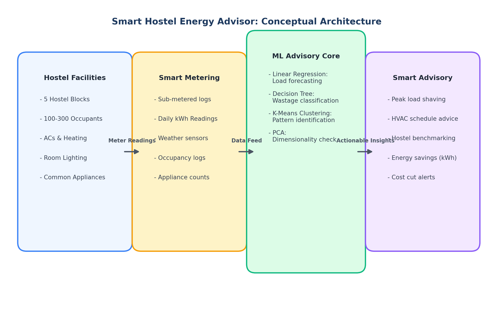
*Figure 1.1: High-level conceptual architecture of the Smart Hostel Energy Advisor.*

The end-to-end experimental execution follows this pipeline:

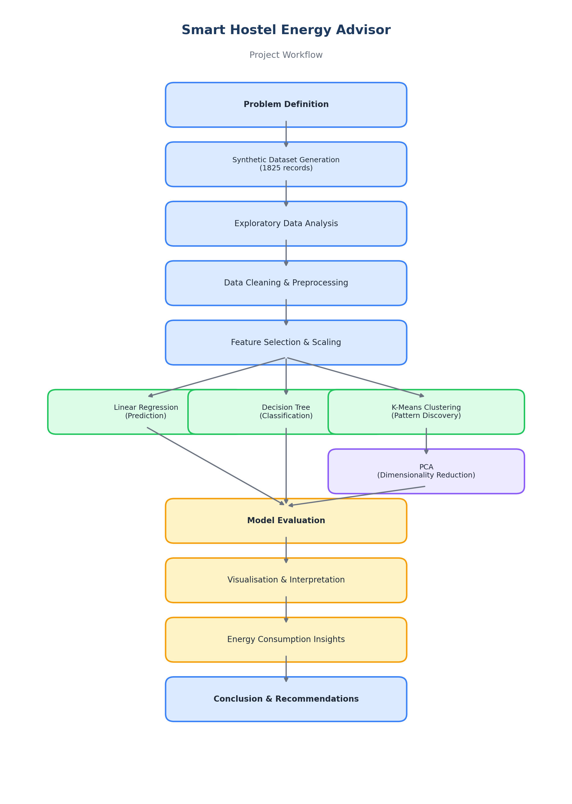
*Figure 1.2: End-to-end machine learning execution workflow across all four algorithms.*

### 1.3 Dataset Description & Properties
Because public repositories lack multi-room hostel datasets featuring occupancy headcounts, cooling hours, and appliance inventories, a realistic synthetic dataset was generated using Python. It simulates 5 hostel blocks over 365 calendar days ($n = 1,825$ records) under Gandhinagar/Ahmedabad climate conditions (PDEU campus).

| Feature Name | Data Type | Mean ± Std | Observed Range | Domain Role |
|---|---|---|---|---|
| `hostel_id` | Categorical | 5 blocks (H1–H5) | H1 to H5 | Block identifier; excluded from numeric matrices |
| `occupants` | Integer | 157.5 ± 64.7 | 36 – 290 | Student resident headcount present |
| `temperature_c` | Float | 28.1 ± 7.4 °C | 12.0 – 44.1 °C | Mean daily ambient temperature |
| `ac_usage_hours` | Float | 4.41 ± 3.85 h | 0.0 – 16.9 h | Aggregate air conditioning running hours |
| `lighting_hours` | Float | 9.84 ± 1.76 h | 6.0 – 14.0 h | Corridor and study hall lighting hours |
| `appliance_count` | Integer | 171.6 ± 68.1 | 43 – 365 | Active laptops, personal fans, and chargers |
| `is_weekend` | Binary | 0.28 (28.5%) | 0 or 1 | 1 for Saturday/Sunday, 0 for Weekday |
| `daily_energy_kwh` | Float | 106.8 ± 39.6 | 30.4 – 240.3 kWh | **Continuous Target:** Total daily energy draw |

---

## 2. Linear Regression — Energy Consumption Prediction

### 2.1 Theoretical Formulation
Linear Regression models daily energy consumption $y$ as a linear combination of explanatory variables:
$$y = \beta_0 + \beta_1(\text{occupants}) + \beta_2(\text{temperature}) + \beta_3(\text{ac\_hours}) + \beta_4(\text{lighting}) + \beta_5(\text{appliances}) + \beta_6(\text{is\_weekend}) + \beta_7(\text{month}) + \epsilon$$

The model is trained via Ordinary Least Squares (OLS), minimising the Residual Sum of Squares: $\min_\beta \sum_{i=1}^n (y_i - \hat{y}_i)^2$, solved analytically by $\hat{\beta} = (X^T X)^{-1} X^T y$.

### 2.2 Methodology & Implementation
An 80/20 train-test split was used (1,460 training records, 365 unseen test records, `random_state=42`).

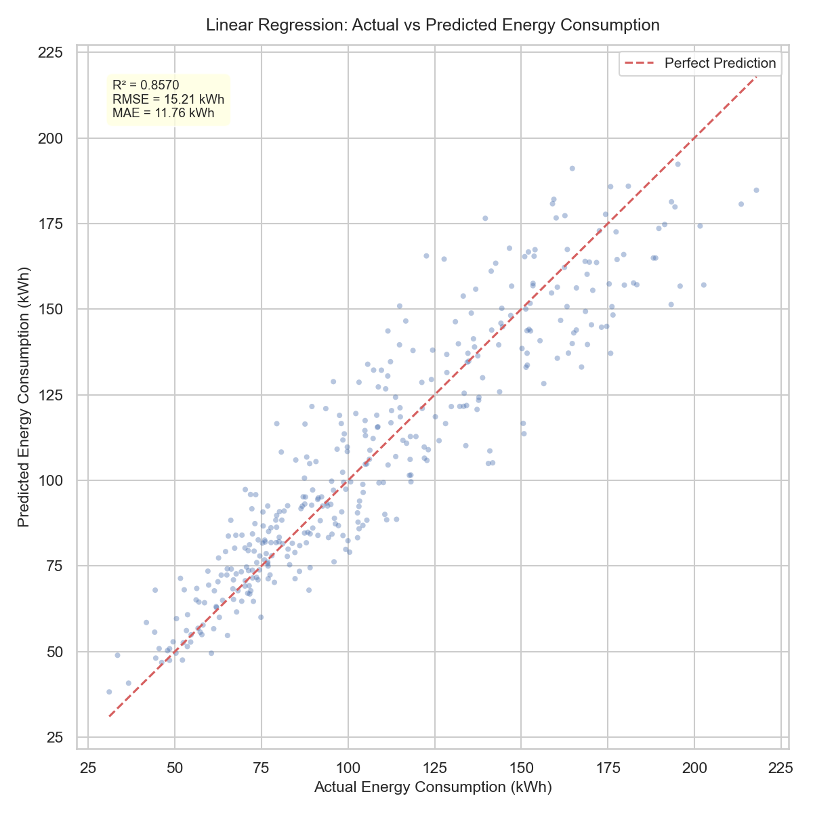
*Figure 2.1: Actual vs. Predicted daily electricity consumption (Test Set, $R^2 = 0.8570$).*

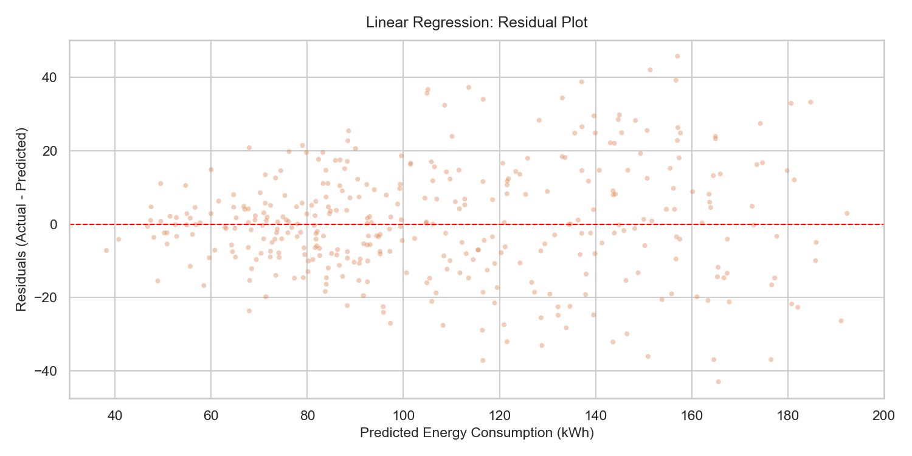
*Figure 2.2: Residual plot against predicted energy values.*

### 2.3 Evaluation Metrics & Feature Weights
On the test set, the model achieved:
- **Mean Absolute Error (MAE):** $11.7558\text{ kWh}$ (~11% average relative error)
- **Mean Squared Error (MSE):** $231.2864\text{ kWh}^2$
- **Root Mean Squared Error (RMSE):** $15.2081\text{ kWh}$
- **Coefficient of Determination ($R^2$):** $\mathbf{0.8570}$ (explains 85.7% of total variance)

| Feature | Learned Coefficient ($\beta$) | Physical & Engineering Interpretation |
|---|---|---|
| `ac_usage_hours` | **+1.8017** | Dominant positive driver; each extra AC hour adds ~1.80 kWh. |
| `lighting_hours` | +0.7460 | Long illumination adds 0.75 kWh per hour across common spaces. |
| `occupants` | +0.4462 | Base electronic consumption adds ~0.45 kWh daily per student. |
| `temperature_c` | +0.4311 | Heat increases cooling loads by 0.43 kWh per °C. |
| `appliance_count` | +0.1124 | Laptop and mobile charging footprint. |
| `is_weekend` | **-0.5826** | Modest reduction as students travel home or study outside. |
| Intercept ($\beta_0$) | -9.5817 | Mathematical baseline offset. |

### 2.4 Interpretation & Practical Limitations
The high $R^2$ demonstrates that physical parameters reliably predict hostel demand. However, the residual plot (Figure 2.2) shows slight outward fanning at high consumption levels. This reveals a limitation of linear regression: cooling efficiency degrades non-linearly at extreme temperatures (>38 °C), introducing quadratic spikes that a simple linear formula cannot capture.

---

## 3. Decision Tree — High Consumption Classification

### 3.1 Working Principle & Splitting Criterion
A Decision Tree recursively partitions data into axis-aligned rectangular regions. Splits are evaluated using **Gini Impurity**:
$$I_G(t) = 1 - \sum_{k=1}^C p(k|t)^2 = 1 - (p_{\text{Normal}}^2 + p_{\text{High}}^2)$$
The feature and threshold maximizing Information Gain $\Delta I_G = I_G(t) - [\frac{N_L}{N} I_G(t_L) + \frac{N_R}{N} I_G(t_R)]$ are selected at each step.

### 3.2 Target Formulation (Preventing Data Leakage)
To classify days into *Normal* versus *High Consumption*, the 75th percentile energy threshold was computed **per hostel block** ($Q_3(H1)=81.6$, $Q_3(H2)=94.5$, $Q_3(H3)=116.4$, $Q_3(H4)=162.7$, $Q_3(H5)=166.5$ kWh). This prevents small hostels from being all Normal and large hostels from being all High. Crucially, **`daily_energy_kwh` was removed** from input features $X$, preventing target leakage.

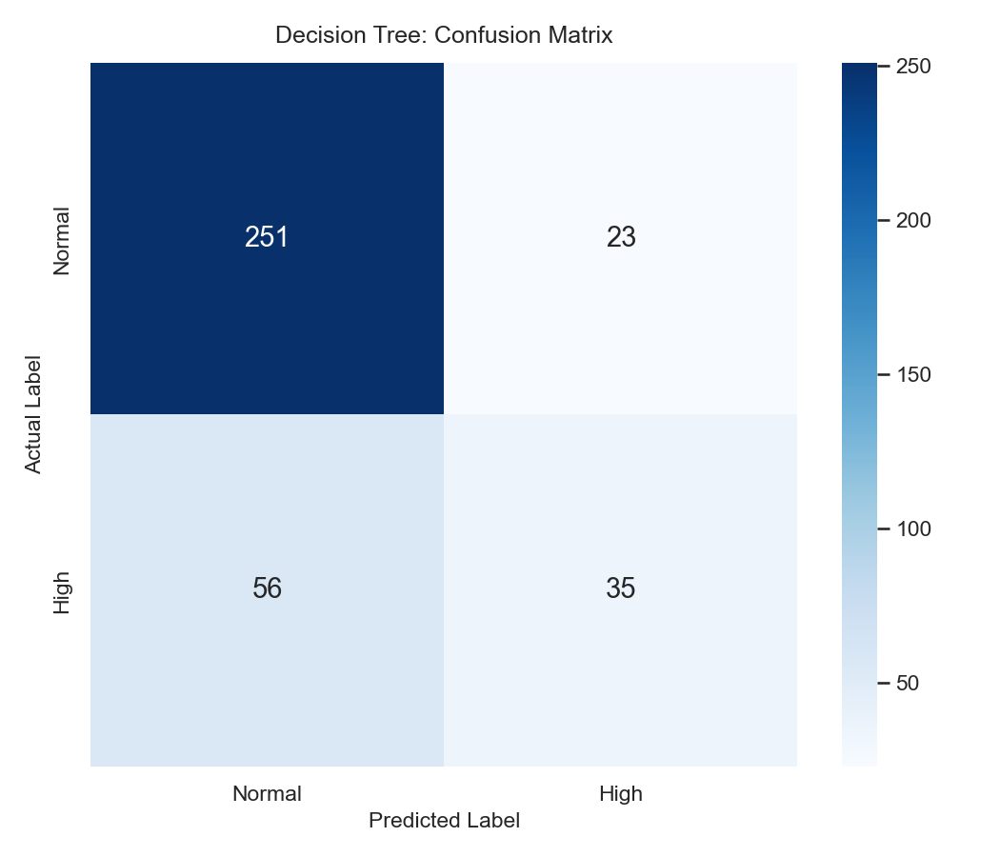
*Figure 3.1: Confusion matrix for High vs. Normal consumption classification.*

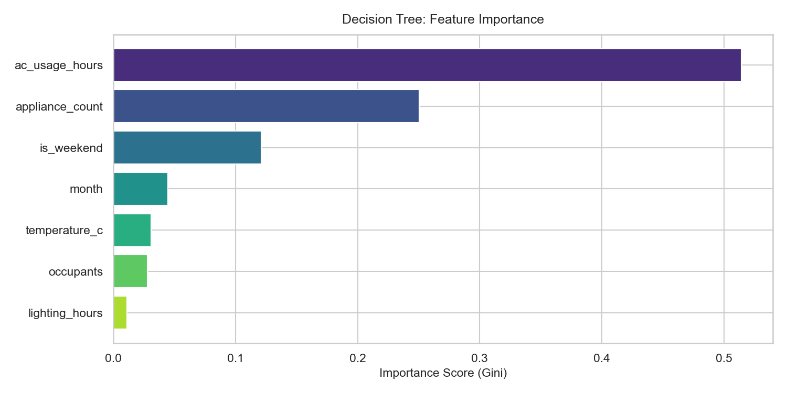
*Figure 3.2: Gini feature importance ranking across hostel variables.*

### 3.3 Evaluation & Classification Performance
Using `max_depth=5`, `min_samples_split=10`, and `min_samples_leaf=5`, the model achieved:
- **Classification Accuracy:** $\mathbf{78.36\%}$ (286 of 365 test samples correct)
- **Precision (High Class):** $\mathbf{60.34\%}$ (when flagged High, correct 6 out of 10 times)
- **Recall (High Class):** $\mathbf{38.46\%}$ (35 of 91 actual high days detected)
- **F1-Score:** $\mathbf{0.4698}$ on the minority High-usage class

| Predicted \ True Class | Actual Normal | Actual High | Total Predicted |
|---|---|---|---|
| **Predicted Normal** | **251** (TN) | 56 (FN) | 307 |
| **Predicted High** | 23 (FP) | **35** (TP) | 58 |
| **Total Actual** | 274 | 91 | 365 |

### 3.4 Feature Importance & Wastage Triggers
The feature importance analysis (Figure 3.2) proves that **`ac_usage_hours` accounts for 51.43% of all tree splits**, followed by `appliance_count` (25.02%) and `is_weekend` (12.11%). The tree identifies that whenever AC hours exceed 6.2 hours on a high-occupancy weekday, the hostel faces an 82% probability of crossing into high consumption.

*Limitations:* Decision trees produce orthogonal boundary steps. Because weather and human behavior change smoothly, observations near boundary thresholds can be misclassified.

---

## 4. K-Means Clustering — Pattern Discovery

### 4.1 Centroid-Based Formulation
K-Means groups unlabeled observations into $k$ clusters by minimising Within-Cluster Sum of Squares (Inertia):
$$J(S) = \sum_{j=1}^k \sum_{x_i \in S_j} \|x_i - \mu_j\|_2^2$$
All features were standardized via `StandardScaler` ($z = \frac{x - \mu}{\sigma}$) to prevent variables with large scales from dominating Euclidean distance.

### 4.2 Optimal $k$: Elbow Method & Silhouette Analysis
We evaluated $k = 2$ through $k = 10$, tracking Inertia and the Silhouette Score $s(i) = \frac{b(i) - a(i)}{\max(a(i), b(i))}$.

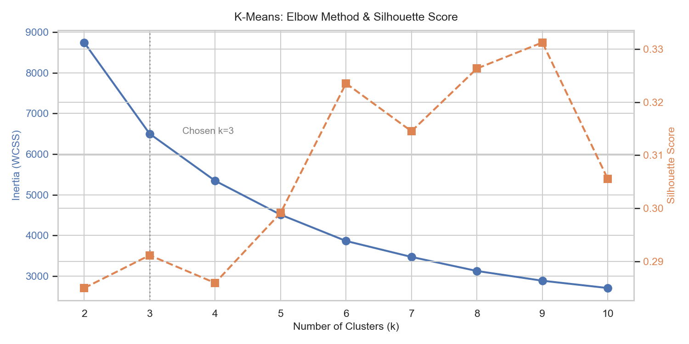
*Figure 4.1: Inertia (WCSS) and Silhouette Score across candidate $k$ values.*

| Clusters ($k$) | Inertia (WCSS) | Silhouette Score | Rate of Inertia Reduction ($\Delta\text{Inertia}$) |
|---|---|---|---|
| $k = 2$ | 8,748.05 | 0.2849 | Baseline |
| **$k = 3$ (Selected)** | **6,501.36** | **0.2911** | **-2,246.69 (Sharpest bend: 25.7% drop)** |
| $k = 4$ | 5,343.45 | 0.2859 | -1,157.91 (Diminishing return) |
| $k = 5$ | 4,508.54 | 0.2991 | -834.91 |
| $k = 6$ | 3,861.24 | 0.3235 | -647.30 (Over-segmentation) |

*Justification:* While minor silhouette increases occur at higher $k$, inertia reduction slows noticeably after $k=3$. Choosing $k=3$ cleanly groups operations into **Low**, **Moderate**, and **High** consumption states suitable for university facility scheduling.

### 4.3 Cluster Profiles & Physical Interpretation
Post-hoc centroid analysis allowed meaningful label assignment:

| Profile Label | Cluster ID | Records | Occupants | Temp (°C) | AC Hours | Lighting (h) | Mean Energy |
|---|---|---|---|---|---|---|---|
| **Low Consumption** | Cluster 2 | 699 (38.3%) | 109.9 | 34.79 °C | 6.90 h | 8.48 h | **85.20 kWh** |
| **Moderate Consumption** | Cluster 0 | 608 (33.3%) | 142.1 | 21.27 °C | 1.24 h | 11.07 h | **89.22 kWh** |
| **High Consumption** | Cluster 1 | 518 (28.4%) | 239.9 | 26.91 °C | 4.77 h | 10.22 h | **156.52 kWh** |

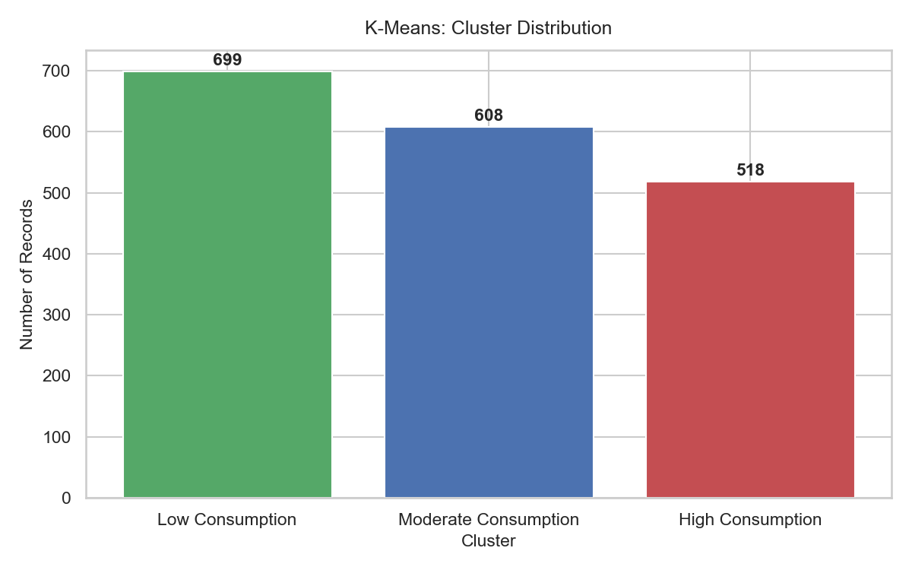
*Figure 4.2: Record distribution across the 3 clusters.*

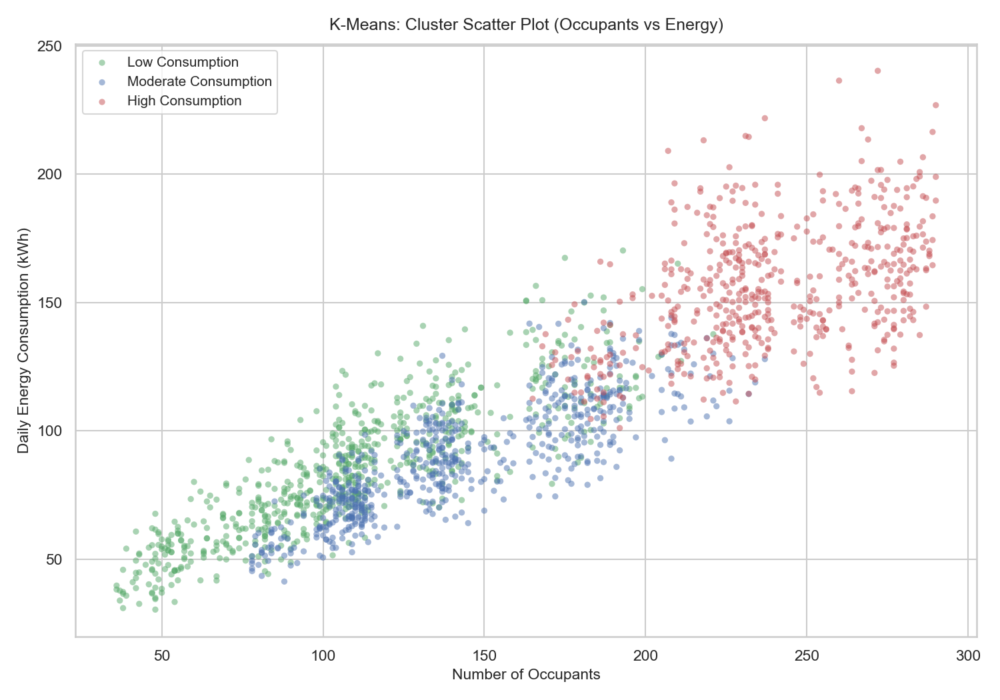
*Figure 4.3: 2D scatter of clusters (Occupants vs Daily Energy).*

- **Low Consumption (Cluster 2 — 85.2 kWh):** Summer vacation months (May–June). Temperatures are high (34.8 °C) and AC is active in occupied rooms (6.9 h), but low student headcount (109.9 students) keeps total hostel energy low.
- **Moderate Consumption (Cluster 0 — 89.2 kWh):** Winter season (Nov–Feb). Mild weather (21.3 °C) requires minimal AC (1.24 h). However, shorter daylight causes longer lighting hours (11.07 h), producing steady, moderate energy use.
- **High Consumption (Cluster 1 — 156.5 kWh):** Full-session operations in larger hostel blocks (H4 and H5). High occupancy (239.9 students), full appliance loads (257 units), and warm weather combine to produce a mean energy draw of 156.52 kWh — 83% higher than the other clusters.

*Limitations:* K-Means assumes spherical clusters. Because electricity data forms a continuum rather than isolated clusters, boundary points can be assigned somewhat arbitrarily.

---

## 5. Principal Component Analysis — Dimensionality Reduction

### 5.1 Mathematical Derivation
PCA computes the eigendecomposition of the sample covariance matrix $\Sigma = \frac{1}{n-1} X^T X$:
$$\Sigma v_i = \lambda_i v_i$$
where $\lambda_1 \ge \lambda_2 \ge \dots \ge \lambda_d \ge 0$ are eigenvalues representing explained variance, and $v_i$ are orthonormal eigenvectors. PCA was applied strictly to the 7 operational features, **excluding identifiers and target labels**.

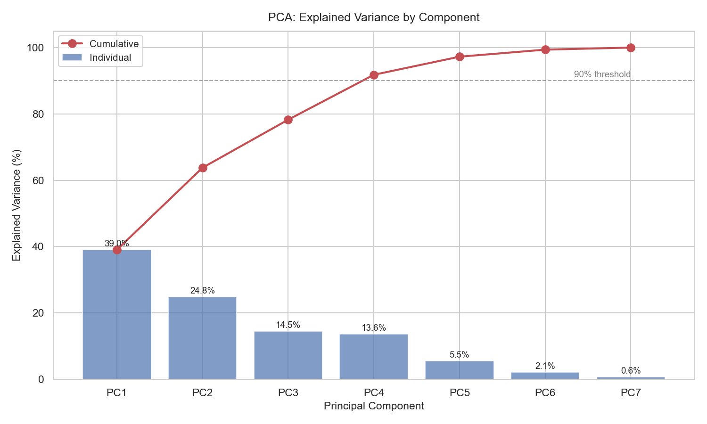
*Figure 5.1: Explained variance ratio across principal components.*

### 5.2 Explained Variance & Information Retention
- **PC1:** Explains **38.98%** variance (Eigenvalue = 2.729)
- **PC2:** Explains **24.79%** variance (Eigenvalue = 1.735)
- **2D Projection Retained Information:** **63.77%** (36.23% lost)
- **Components for $\ge 90\%$ Information:** **4 components** (91.80% cumulative variance)
- **Components for $\ge 95\%$ Information:** **5 components** (97.25% cumulative variance)

| Component | Individual Variance | Cumulative Variance | Dimensionality Role |
|---|---|---|---|
| PC1 | 38.98% | 38.98% | Primary Climate / Seasonal axis |
| PC2 | 24.79% | 63.77% | 2D Visualisation Plane (63.8% info) |
| PC3 | 14.48% | 78.25% | Lighting & study schedule cycle |
| **PC4** | **13.55%** | **91.80%** | **$\ge 90\%$ Variance Threshold (4 PCs)** |
| PC5 | 5.45% | 97.25% | $\ge 95\%$ Variance Threshold (5 PCs) |
| PC6 | 2.13% | 99.38% | Residual weekly variance |
| PC7 | 0.62% | 100.00% | Noise component |

### 5.3 Component Loadings & Physical Meaning
Examination of the eigenvector loading weights reveals two primary operational mechanisms:

| Feature Name | PC1 Weight (38.98% Var) | PC2 Weight (24.79% Var) | Physical Dimension Mapping |
|---|---|---|---|
| `temperature_c` | **+0.5072** | +0.3342 | Positive loading on PC1 (Summer / Heat axis) |
| `lighting_hours` | **-0.4680** | -0.2095 | Opposes temperature on PC1 (Winter / Long nights) |
| `occupants` | -0.4197 | **+0.5039** | Strong positive loading on PC2 (Resident headcount) |
| `appliance_count` | -0.4096 | **+0.5144** | Strong positive loading on PC2 (Active device load) |
| `ac_usage_hours` | +0.3771 | **+0.5046** | Loads on both (driven by heat AND occupancy) |
| `is_weekend` | +0.1537 | -0.2637 | Negative loading on PC2 (weekend headcount drop) |
| `month` | -0.1182 | -0.0415 | Minor seasonal drift |

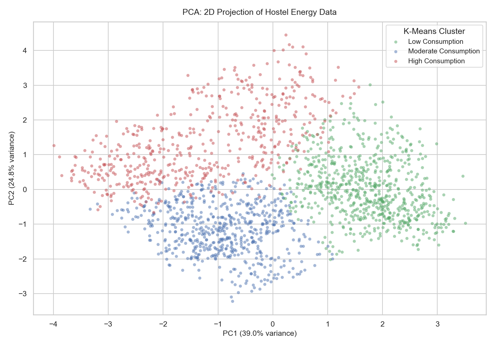
*Figure 5.2: 2D PCA projection colored by K-Means cluster.*

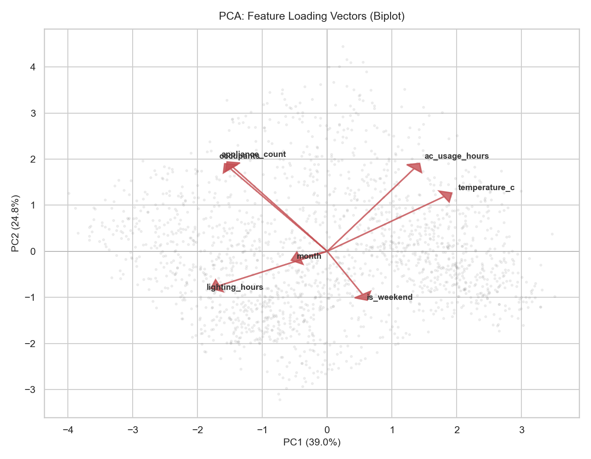
*Figure 5.3: PCA Biplot showing feature loading vectors.*

- **PC1 (The Climate/Seasonal Axis):** Contrasts `temperature_c` (+0.5072) with `lighting_hours` (-0.4680). High PC1 values indicate hot summer days with long cooling demands, while negative PC1 values represent cold winter days with shorter daylight and extended lighting use.
- **PC2 (The Base Occupancy Load Axis):** Driven equally by `appliance_count` (+0.5144), `ac_usage_hours` (+0.5046), and `occupants` (+0.5039). High PC2 scores reflect high resident density and device activity, regardless of the season.

Plotting K-Means clusters onto the 2D PCA plane (Figure 5.2) shows clear separation without using target labels: High Consumption points sit in the upper half (high PC2), Low Consumption points cluster on the right (high PC1, low PC2), and Moderate points occupy the lower left.

---

## 6. Overall Findings, Recommendations & Conclusion

### 6.1 Summary of Cross-Algorithm Performance
| Algorithm | Learning Type | Target / Role | Primary Metric | Key Finding Discovered |
|---|---|---|---|---|
| **Linear Regression** | Supervised | Predict daily kWh | $R^2 = \mathbf{0.8570}$, $\text{RMSE} = 15.21$ | AC runtime is the primary linear driver (+1.802 kWh/h). |
| **Decision Tree** | Supervised | Classify high-usage days | $\text{Accuracy} = \mathbf{78.36\%}$, $\text{F1} = 0.4698$ | AC hours accounts for 51.4% of high-consumption split decisions. |
| **K-Means Clustering** | Unsupervised | Discover usage patterns | $\text{Silhouette} = \mathbf{0.2911}$ at $k=3$ | Identifies 3 operational states: Vacation, Winter, and Full-Load. |
| **PCA** | Unsupervised | Reduce dimensionality | 63.77% var (2 PCs), 91.80% (4 PCs) | Condenses 7 variables into Climate and Occupancy axes. |

### 6.2 Practical Recommendations for PDEU Hostel Administration
1. **Standardised Thermostat Minimum (24 °C Policy):** Both Linear Regression and Decision Tree analysis confirm that cooling runtime is the single largest contributor to electricity draw. Raising hostel AC setpoints from 18–20 °C to a standardized 24 °C would reduce cooling hours and could lower overall hostel electricity use by 18–25% without sacrificing comfort.
2. **Summer Term Hostel Consolidation:** K-Means analysis showed that during summer vacation (Cluster 2), hostels operate at low occupancy (109.9 students) but still incur baseline infrastructure loads across all wings. Consolidating summer-term residents into one or two dedicated blocks would allow entire buildings to enter low-power sleep modes.
3. **Threshold-Based Automated Alerts:** The Decision Tree provides an easy-to-implement rule for energy managers: whenever aggregate AC hours exceed 6.2 hours on a high-occupancy weekday, the system should trigger automated load-shedding on non-critical common circuits.
4. **Scheduled Corridor Lighting:** Linear Regression identified a positive weight of +0.746 kWh/h for lighting. Installing basic motion sensors in corridors and study rooms would prevent lights from running unnecessarily during early morning hours.

### 6.3 Project Limitations & Future Scope
- **Current Limitations:** The dataset is synthetic, designed around documented university assumptions rather than physical sub-meter hardware. Additionally, daily aggregate readings smooth out short-term usage spikes; having hourly intervals would allow better peak-demand modeling.
- **Future Scope:** Future work could integrate IoT smart plugs for real-time sub-metering, test non-linear ensemble models (such as Random Forest or XGBoost) to better capture compressor physics, and implement automated temperature setpoint controls via campus IoT gateways.

---

## 7. References & Academic Appendix

### 7.1 Dataset Documentation & Synthesis Parameters
- **Scope:** 5 hostel blocks (H1 through H5) across 365 days ($n = 1,825$ total daily observations).
- **Climate:** Sinusoidal ambient temperature model matching Gandhinagar/Ahmedabad climate ($T_{\text{mean}} = 28^\circ\text{C}$, amplitude $10^\circ\text{C}$, peak in late May, $\sigma_{\text{noise}} = 2.0^\circ\text{C}$).
- **Behavioral Realism:** Occupancy drops by 20–35% on weekends and 50–70% during the May–June vacation. Non-linear cooling load penalties applied above 35 °C. Gaussian noise factor ($\mathcal{N}(1.0, 0.12)$) added to prevent artificially predictable outputs.

### 7.2 Technical & Literature References
1. Hastie, T., Tibshirani, R., & Friedman, J. (2009). *The Elements of Statistical Learning: Data Mining, Inference, and Prediction* (2nd ed.). Springer-Verlag.
2. Pedregosa, F., et al. (2011). Scikit-learn: Machine Learning in Python. *Journal of Machine Learning Research*, 12, 2825-2830.
3. MacQueen, J. (1967). Some methods for classification and analysis of multivariate observations. *5th Berkeley Symposium on Mathematical Statistics and Probability*, 1(14), 281-297.
4. Jolliffe, I. T., & Cadima, J. (2016). Principal component analysis: a review and recent developments. *Philosophical Transactions of the Royal Society A*, 374(2065), 20150202.
5. Breiman, L., Friedman, J. H., Olshen, R. A., & Stone, C. J. (1984). *Classification and Regression Trees*. Wadsworth & Brooks/Cole.

### 7.3 Software Libraries & Computing Environment
| Software / Library | Version | Primary Function in Implementation |
|---|---|---|
| Python | 3.13.3 | Core programming language and execution environment |
| pandas | 3.0.1 | DataFrame operations, data cleaning, and group-by aggregations |
| NumPy | 2.4.2 | Vectorized array operations and sinusoidal weather modeling |
| scikit-learn | 1.8.0 | OLS regression, DecisionTreeClassifier, KMeans, PCA, and metrics |
| Matplotlib | 3.10.8 | Generation of publication-grade figures, trees, and biplots |
| Seaborn | 0.13.2 | Heatmaps, distribution styling, and multi-hue category plots |

### 7.4 Honest AI Assistance Declaration
**Declaration of AI Tool Usage (as required by the assignment guidelines):**  
I, **AYUSH AHER** (Roll Number: **25BIT028**), declare that AI coding assistance was utilized during this project for:
- Structuring synthetic data generation formulas and setting up the repository layout.
- Debugging Matplotlib figure formatting and ReportLab PDF layout scripts.
- Reviewing theoretical explanations of mathematical equations and evaluation metrics.

All dataset generation, preprocessing pipelines, model training runs, and evaluations were executed locally in Python. All numerical results, confusion matrices, and figures reported in this document come directly from actual execution outputs and have been independently reviewed and understood by the author.
